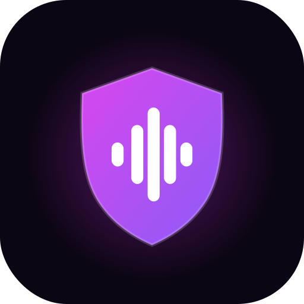

<p align="center">
  
</p>

# Voz Segura — Frontend

Botón de pánico silencioso para smartwatch, caso de estudio de **Diseño de Interfaces de
Software**. Un doble toque discreto en la carátula del reloj activa la grabación de audio
y envía la ubicación a contactos de confianza, sin nada visible en pantalla y sin sonido.

Es una sola app React que se usa de tres formas: en el PC (navegador, con un mockup del
reloj), en el celular como **app Android** hecha con Capacitor (el celular hace de reloj) y,
para la persona de confianza, como página web. Tiene tres vistas:

| Vista             | Ruta               | Para quién                                   |
| ----------------- | ------------------ | -------------------------------------------- |
| **Reloj**         | `/`                | La persona en riesgo. En PC se ve un mockup de reloj; en la app Android ocupa la pantalla completa como si fuera un reloj. |
| **Configuración** | `/configuracion`   | App compañera: contactos, mensaje, práctica del gesto, historial y modo demo. |
| **Contacto**      | `/alerta/:alertId` | Lo que recibe la persona de confianza: mapa, hora, estado y resumen de la IA. |

El backend (funciones serverless que guardan la alerta, avisan por Telegram y resumen el
audio con IA) está en [VozSegura-backend](https://github.com/MarioZaMu/VozSegura-backend).

## Abrirla en línea

👉 **[voz-segura-frontend.vercel.app](https://voz-segura-frontend.vercel.app)** — en el PC o en el celular, sin instalar nada.

- **En el PC** se ve el mockup del reloj y arriba la navegación entre las vistas (Reloj,
  Configuración, Contacto demo y Diseño). Haz doble clic rápido en la carátula para probar
  el gesto.
- **En el celular** el reloj ocupa toda la pantalla; desde el menú del navegador se puede
  "Agregar a la pantalla principal". Para grabar con la pantalla bloqueada usa la app
  Android (ver [App Android](#app-android-capacitor)).
- Activa el **modo demo** en Configuración para probar sin avisar a nadie.

## Stack

React 19 · Vite 8 · TypeScript · Tailwind CSS v4 · React Router · Capacitor 8 (Android) · Vitest · oxlint · Vercel

## Cómo correrlo

Requisitos: Node.js 20 o superior.

```bash
npm install
cp .env.example .env   # ajusta VITE_API_BASE_URL a la URL del backend
npm run dev            # http://localhost:5173
```

Otros comandos:

```bash
npm run build     # verificación de tipos + build de producción en dist/
npm run lint      # análisis estático con oxlint
npm test          # pruebas unitarias con Vitest
npm run preview   # sirve dist/ localmente
```

> En el celular, el micrófono y la ubicación solo funcionan sobre HTTPS. Para probar en
> el teléfono usa la URL de Vercel.

## App Android 

Requisitos: Android Studio instalado (trae el JDK y el SDK de Android).

```bash
npm run android:sync     # build web + copia a android/
npm run android:build    # genera android/app/build/outputs/apk/debug/app-debug.apk
npm run android:install  # instala el APK en el celular conectado por USB
```

Para instalar por USB, activa en el celular *Opciones de desarrollador → Depuración USB*.
También puedes copiar el APK al celular e instalarlo a mano (permite "instalar apps de
orígenes desconocidos"). Para ver la consola de la app, conecta el celular y abre
`chrome://inspect` en el Chrome del PC.

## Cómo desplegarlo (Vercel)

1. En [vercel.com/new](https://vercel.com/new) importa el repo `VozSegura-Frontend`.
2. Vercel detecta Vite: build `npm run build`, salida `dist`.
3. En *Settings → Environment Variables* agrega `VITE_API_BASE_URL` con la URL del backend.
4. Cada push a `main` despliega automáticamente.

`vercel.json` redirige todas las rutas a `index.html` para que `/alerta/...` funcione al
recargar.

## Licencia

Proyecto académico.
